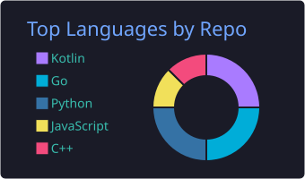
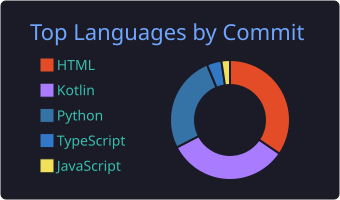
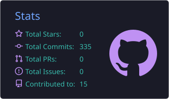
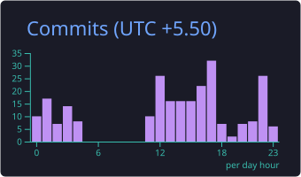

<p align="center">
  Ikiru
</p>

```zsh
> neofetch
```


```csharp
varad-oss@github
-----------------
OS: macOS
Host: IIT Kharagpur
Shell: zsh
Editor: VS Code

Role: Software Developer
Domain: Distributed Systems • Agentic AI • Android • Full Stack

Languages:
  Go • Python • C++ • Kotlin
  JavaScript • C • HTML/CSS

Core Skills:
  Distributed Systems - Raft consensus, replication, RPC
  Systems Programming - LSM-trees, WAL, bitboards
  Concurrent & Networked Systems - sockets, protocol design
  Applied AI - LLM pipelines

Databases:
  PostgreSQL • MySQL • Firebase • Neo4j

Cloud & DevOps:
  AWS • Docker • Git


```

<br clear="both"/>

<p align="center">

</p>

<p align="center">
  
</p>

<p align="center">
  
  
</p>

<p align="center">
  
  
</p>

<!--
**varad-oss/varad-oss** is a ✨ _special_ ✨ repository because its `README.md` (this file) appears on your GitHub profile.

Here are some ideas to get you started:

- 🔭 I'm currently working on ...
- 🌱 I'm currently learning ...
- 👯 I'm looking to collaborate on ...
- 🤔 I'm looking for help with ...
- 💬 Ask me about ...
- 📫 How to reach me: ...
- 😄 Pronouns: ...
- ⚡ Fun fact: ...
-->
